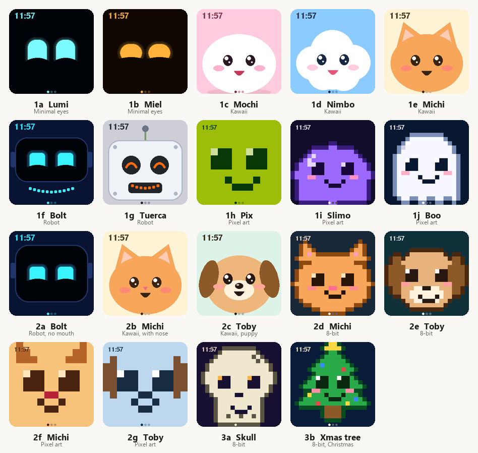
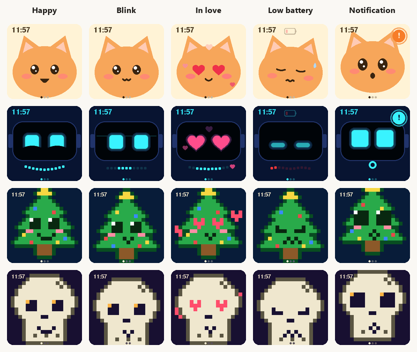
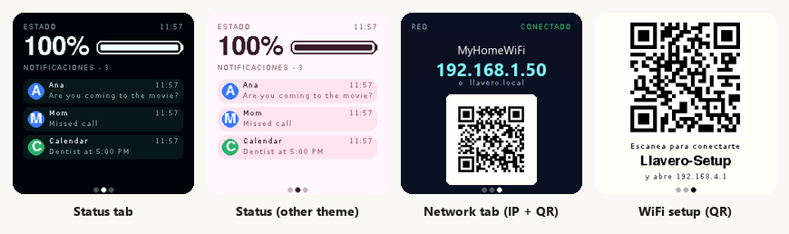

# Llavero Amigo — an animated pet keychain

[](LICENSE)
[](https://www.espressif.com/en/products/socs/esp32-c3)
[](https://platformio.org)

**Llavero Amigo** ("Friend Keychain") is a pocket-sized digital pet. A 240×240 colour display shows an animated character that blinks, falls in love, gets sleepy when the battery runs low and jumps when a notification arrives. A touch button flips between the face, a status screen (battery + notifications) and a network screen. Everything is configured from your phone through a small web page served by the keychain itself — no app and no cloud.



## Features

- **19 characters** in four styles — minimalist glowing eyes, kawaii, robots and pixel art — each with **5 animated expressions** (happy, blink, in love, low battery, notification).
- **Automatic mood.** A new notification (5 s) > low battery > random idle expressions (happy / blink, with the odd "in love").
- **Status tab:** battery gauge and the last 3 notifications, themed per character.
- **Network tab:** shows the keychain's IP address and a QR code that opens its web page.
- **Web UI** (`http://llavero.local` or its IP): pick the character, force an expression, send test notifications, manage WiFi and set the clock. Character thumbnails and a live view of the screen are rendered by the keychain itself, so you see exactly what the display shows.
- **WiFi that just works:** remembers up to 6 networks and joins the strongest one it can see. With no network it starts a setup access point and shows a **QR code** on the screen — scan it, pick your WiFi, done. Faces keep working with no WiFi at all.
- **Over-the-air updates** (ArduinoOTA, password protected).
- **Clock** from NTP, or set by hand from your phone when offline.
- **Real battery level** from a LiPo cell through a voltage divider (falls back to a simulated value when no cell is connected).
- **3D-printable case** (FreeCAD source + STL).





## Hardware

| Part | Notes |
|------|-------|
| ESP32-C3 mini board | Any ESP32-C3 board with native USB and 4 MB flash. Developed on a "mini" board (USB `303A:1001`, rev v0.4) |
| 1.54" ST7789 IPS display, 240×240, SPI | The common 7-pin module (no CS pin) |
| TTP223 capacitive touch module | The ESP32-C3 has no touch sensor of its own |
| 3.7 V LiPo cell, 1200 mAh | **Protected** cell. Charger module (e.g. TP4056) not covered |
| SPDT slide switch | Used as power on/off |
| 2 × 100 kΩ resistors (+ optional 100 nF capacitor) | Battery voltage divider |
| 3D-printed case | [`hardware/case/`](hardware/case) — body 69.4 × 45 × 22 mm, lid 60 × 45.1 × 6.8 mm |

### Wiring


| Function | ESP32-C3 pin |
|----------|--------------|
| Display SCK / MOSI | GPIO4 / GPIO6 |
| Display DC / RST / BL | GPIO5 / GPIO3 / GPIO10 |
| TTP223 output | GPIO1 |
| Battery sense (ADC) | GPIO0 (through a 100 kΩ + 100 kΩ divider) |
| Power | battery → switch → 5V/VIN |

> ⚠️ **Never wire the LiPo directly to a GPIO** — a full cell is 4.2 V and the ESP32-C3 pins tolerate 3.3 V. Also check that your board's 5V pin goes through a low-dropout regulator and has a diode. Details, caveats and troubleshooting are in **[docs/WIRING.md](docs/WIRING.md)**.

### Battery life

These are **estimates from typical component currents, not measurements**.

| Part | Current |
|------|---------|
| ESP32-C3, WiFi connected, CPU always busy, 30 fps | 45–60 mA |
| ST7789 module with backlight at full brightness | 30–40 mA |
| Divider + touch module | < 0.03 mA |
| **Total** | **≈ 85–100 mA** |

A 1200 mAh cell gives about 1000 mAh usable (the board browns out near 3.3 V), so expect **roughly 8–12 hours** (best case ≈ 17 h, worst ≈ 8 h). Planned savings: backlight PWM (~20 mA), 80 MHz CPU (~10–15 mA), 15 fps when idle (~10–15 mA) and screen-off after inactivity — together that should reach 25–30 h.

## Getting started

### 1. Build and flash

You need [PlatformIO](https://platformio.org/install) (CLI or VS Code extension).

```bash
git clone https://github.com/<you>/llavero-amigo.git
cd llavero-amigo

# optional: preload a WiFi network and set your OTA password
cp src/secrets.example.h src/secrets.h      # then edit it

pio run -e esp32c3 -t upload                # flash over USB
```

`src/secrets.h` is optional: without it the firmware builds with empty defaults and you add your WiFi from the phone (below). **Change `OTA_PASS`** — anyone on your network who knows it can flash the device.

If the board does not show up as a serial port, hold **BOOT**, tap **RESET**, release **BOOT**, then upload.

### 2. Connect it to your WiFi

1. Power it up. With no saved network it opens a setup access point right away (if a saved network is out of range it does so after ~35 s). Tap the button until you reach the **Network** tab — or hold it for 4 s — to see the setup QR.
2. Scan the QR with your phone — it joins `Llavero-Setup` (password `llavero1234`, changeable in `src/config.h`) — and the page opens automatically (or go to `http://192.168.4.1`).
3. Pick your network, enter the password and press **Save**. The keychain shows its new IP and a QR on screen.

From then on it reconnects by itself. You can store up to 6 networks and add or forget them from the web page.

### 3. Over-the-air updates

```bash
cp platformio_local.ini.example platformio_local.ini   # set the keychain IP/host and the OTA password
pio run -e esp32c3_ota -t upload
```

The first flash of a board must be done over USB. Keep `ArduinoOTA.handle()` in the main loop of any custom firmware, otherwise OTA is lost.

## Using it

| Gesture | What it does |
|---------|--------------|
| Tap | Face → Status → Network → Face |
| Hold 4 s | Opens WiFi setup mode (setup QR) |
| (idle) | Status and Network tabs return to the face after 10 s |

**Expressions** are chosen automatically: a fresh *notification* (5 s) wins over *low battery* (< 20 %), which wins over random idle moods (*happy* and *blink* mostly, *in love* ~6 % of the time and only for a couple of seconds). You can force one from the web UI (**Auto** restores the automatic behaviour).

**Clock.** Synced with NTP once online (set `TIMEZONE` in `src/config.h`). Offline, open the web page and press *Use this phone's time* or enter a time by hand.

**Notifications.** The keychain keeps the last 3. There is no phone integration yet — they are pushed over HTTP (see below), which is enough to wire up Tasker / iOS Shortcuts / Home Assistant:

```bash
curl -X POST -d "from=Ana&text=Are you coming tonight?" http://llavero.local/api/notify
```

## HTTP API

Plain HTTP on port 80, **no authentication** — only use it on a network you trust.

| Endpoint | Description |
|----------|-------------|
| `GET /` | Web UI |
| `GET /api/list` | Characters (id, name, style, colours) |
| `GET /api/state` | Current character, expression, battery, WiFi, saved networks, time, free heap, build |
| `GET /api/set?c=<id>&e=<0-4\|-1>` | Select a character and/or force an expression (`-1` = auto) |
| `POST /api/notify` (`from`, `text`) | Push a notification |
| `POST /api/clear` | Clear notifications |
| `POST /api/battery` (`v`=0–100) | Set the simulated battery (only when no cell is detected) |
| `GET /api/scan` | Scan WiFi networks |
| `POST /api/wifi` (`ssid`, `pass`) | Save and connect; omit `pass` to reuse a saved password |
| `POST /api/forget` (`ssid`) | Forget a saved network |
| `POST /api/time` (`t`=unix seconds) | Set the clock |
| `GET /api/frame?c=<id>&e=<0-4>&t=<s>&s=<1\|2>&tab=<status\|net\|setup>` | Render a character (or screen) as a 24-bit BMP, 240 px (`s=1`) or 120 px (`s=2`) |
| `GET /api/screen` | BMP of what the display is showing right now |
| `GET /api/adc` | Battery-pin diagnostics (see [docs/WIRING.md](docs/WIRING.md)) |

Expressions: `0` happy, `1` blink, `2` in love, `3` low battery, `4` notification.

## Configuration

Everything hardware-related lives in [`src/config.h`](src/config.h):

| Setting | Meaning |
|---------|---------|
| `PIN_*` | GPIO assignments for display, button and battery sense |
| `PIN_BAT_ADC`, `BAT_DIV_RATIO`, `BAT_MV_*` | Battery sensing (`-1` disables it) |
| `TFT_INVERT`, `TFT_OFFSET_X/Y`, `TFT_SPI_MODE` | Display quirks (inverted colours, shifted image, SPI mode) |
| `SHOW_CLOCK`, `TIMEZONE` | Clock overlay and POSIX time-zone string |
| `STATUS_TIMEOUT_MS`, `LONG_PRESS_MS` | UI timings |
| `WIFI_TRY_MS`, `MAX_NETS`, `AP_SSID`, `AP_PASS` | WiFi behaviour and setup access point |

## Characters

| ID | Name | Style | ID | Name | Style |
|----|------|-------|----|------|-------|
| 1a | Lumi | Minimal eyes (cyan) | 2a | Bolt | Robot, no mouth |
| 1b | Miel | Minimal eyes (amber) | 2b | Michi | Kawaii cat with nose |
| 1c | Mochi | Kawaii blob | 2c | Toby | Kawaii puppy |
| 1d | Nimbo | Kawaii cloud | 2d | Michi | 8-bit cat |
| 1e | Michi | Kawaii cat | 2e | Toby | 8-bit puppy |
| 1f | Bolt | Robot (visor) | 2f | Michi | Pixel art cat (12×12) |
| 1g | Tuerca | Robot (antenna) | 2g | Toby | Pixel art puppy (12×12) |
| 1h | Pix | Pixel art (green LCD) | 3a | Craneo | 8-bit skull |
| 1i | Slimo | Pixel art slime | 3b | Arbolito | 8-bit Christmas tree |
| 1j | Boo | Pixel art ghost | | | |

The first 17 designs (IDs 1x and 2x) were ported to C++ from an HTML design hand-off; the skull and the tree are new.

### Adding a character

1. In [`src/characters.cpp`](src/characters.cpp) add an entry (`add("4a", "Name", "Style", T_PIXEL)`) and fill in its palette. Status-tab colours go in the `STATUS_PAL` table at the bottom of that file.
2. Reuse one of the four renderers in [`src/faces.cpp`](src/faces.cpp): `minimalFace`, `kawaiiFace`, `robotFace` or `pixelFace`. For a new pixel creature, add a `Body` value and its shape in `bodyAt()` (20×20 grid, one cell = 12 px) — the skull and the tree are good examples.
3. Check the result without a display: `GET /api/frame?c=4a&e=0` returns the rendered image.

## Project structure

```
src/
  main.cpp          WiFi manager, web server + API, button, screens, battery, main loop
  faces.cpp         All drawing: faces, effects, HUD, Status screen
  characters.cpp    Character table (palettes and parameters)
  faces.h           Character / FaceCtx / Notif structures
  display.h         LovyanGFX configuration for the ST7789
  config.h          Pins and behaviour settings
  webpage.h         The web UI (single embedded HTML page)
  secrets.example.h Template for the git-ignored src/secrets.h
hardware/case/      FreeCAD source and STL files for the case
docs/               Wiring guide, diagrams and screenshots
platformio.ini      Build configuration (OTA settings go in platformio_local.ini)
```

Rendering uses a 240×240 RGB565 sprite (≈ 112 KB) pushed to the panel over SPI at 40 MHz, ≈ 30 fps. After boot about 78 KB of heap remain free, and the firmware uses ≈ 78 % of the 1.31 MB OTA application partition.

## Known limitations

- **No phone notifications yet** — only the HTTP API (BLE/companion-app support is the main roadmap item).
- **No charging circuit** is covered; add a protected charger module.
- The web UI and on-screen text are **in Spanish**; the font is ASCII-only (accents are stripped from notification text). Translations are welcome.
- The API and the web page have **no authentication**, and the OTA password lives in plain text in your local config.
- The time zone is a compile-time setting.
- Battery percentage uses a generic LiPo curve and is not calibrated per cell.
- Battery runtime numbers above are estimates.

## Troubleshooting

| Problem | Try |
|---------|-----|
| Colours inverted / image shifted | `TFT_INVERT`, `TFT_OFFSET_Y` in `config.h` |
| Blank screen | Backlight pin, `TFT_SPI_MODE` (3 without CS, 0 with CS) |
| Can't upload ("port busy" / board reboot loop) | Close any serial monitor; hold BOOT, tap RESET, release BOOT |
| OTA can't find the board | Use the IP shown on the Network tab instead of `llavero.local` (Windows often can't resolve mDNS) |
| WiFi never connects | The firmware lowers the TX power (`WIFI_POWER_8_5dBm`), a known fix for ESP32-C3 mini boards; check you are on 2.4 GHz |
| Battery stuck at 100 % | Check the divider wiring; `GET /api/adc` helps — see [docs/WIRING.md](docs/WIRING.md) |

## Contributing

Pull requests are welcome — see [CONTRIBUTING.md](CONTRIBUTING.md). Never commit `src/secrets.h` or `platformio_local.ini`.

## License

The firmware, documentation and the case design files in `hardware/case/` are released under the [MIT License](LICENSE), unless a file says otherwise.

Third-party components keep their own licenses: [LovyanGFX](https://github.com/lovyan03/LovyanGFX) (BSD-2-Clause; the fonts it bundles keep their own licenses), the [Arduino-ESP32](https://github.com/espressif/arduino-esp32) core (LGPL-2.1) and [PlatformIO](https://platformio.org).
