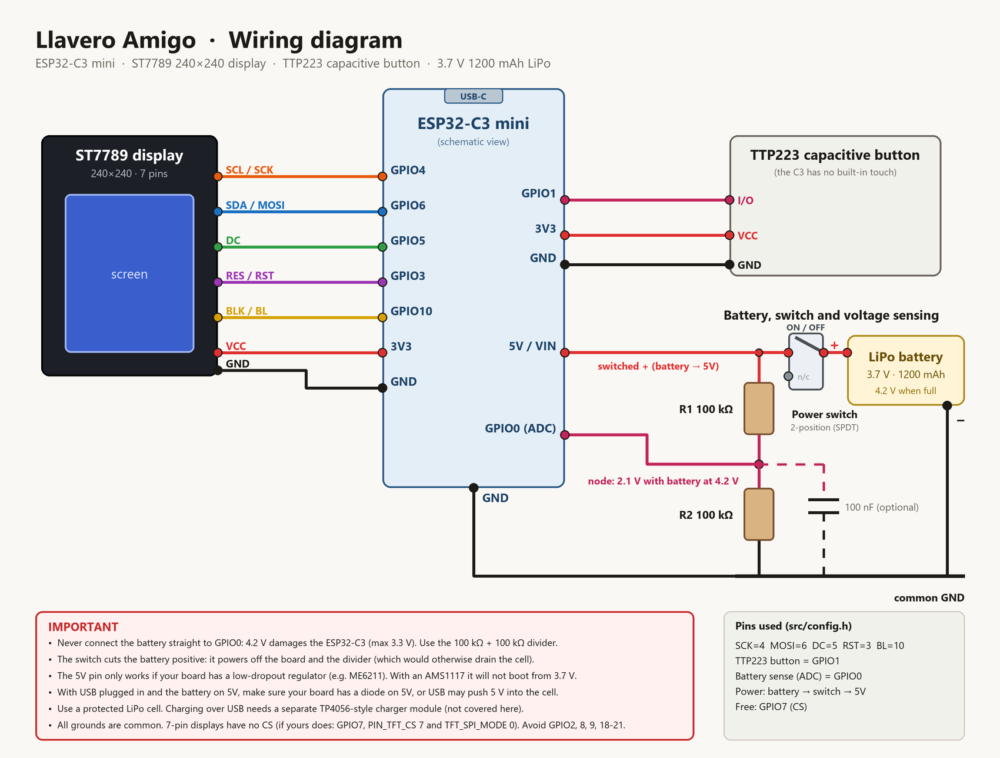

# Wiring

Pins are defined in [`src/config.h`](../src/config.h). If you move a wire, change the number there.
A Spanish version of this page is in [WIRING.es.md](WIRING.es.md).

## ST7789 display (240×240, SPI)

| Display pin   | ESP32-C3 | Note                                                                   |
|---------------|----------|------------------------------------------------------------------------|
| VCC           | 3V3      | 3.3 V                                                                  |
| GND           | GND      |                                                                        |
| SCL / SCK     | GPIO4    |                                                                        |
| SDA / MOSI    | GPIO6    |                                                                        |
| RES / RST     | GPIO3    |                                                                        |
| DC            | GPIO5    |                                                                        |
| BLK / BL      | GPIO10   | Backlight. You can also tie it to 3V3 and free the pin                  |
| CS            | not used | 7-pin modules have no CS. If yours does: wire it to GPIO7, set `PIN_TFT_CS 7` and `TFT_SPI_MODE 0` |

## Touch button (TTP223 module)

The ESP32-C3 has **no built-in capacitive touch** (only the ESP32, S2 and S3 do), so the button is a TTP223 module with a digital output.

| TTP223 | ESP32-C3 |
|--------|----------|
| VCC    | 3V3      |
| GND    | GND      |
| I/O    | GPIO1    |

## LiPo battery, power switch and voltage sensing

Use a 2-position slide switch (SPDT, used as on/off) on the battery positive:

| From                         | To                                         |
|------------------------------|--------------------------------------------|
| Battery (+)                  | switch common terminal                     |
| switch ON terminal           | board **5V/VIN** pin **and** R1 (below)    |
| Battery (−)                  | common GND                                 |

The third terminal of the switch is left unconnected. Switching off also disconnects the voltage divider, so it does not drain the cell.

> **The 5V pin only works if your board has a low-dropout 3.3 V regulator** (e.g. ME6211). With an AMS1117 (≈1.1 V dropout) a 3.7 V cell will not be enough. Also check that the board has a diode on the 5V pin, otherwise USB may push 5 V into the battery. Use a **protected** LiPo cell.

### Voltage divider (to read the battery level)

**Never connect the battery directly to a GPIO.** A full cell is 4.2 V and the ESP32-C3 tolerates 3.3 V at most. Use two equal resistors:

| From                          | To                    |
|-------------------------------|-----------------------|
| switched battery (+)          | R1 = 100 kΩ           |
| R1                            | node → **GPIO0**      |
| node                          | R2 = 100 kΩ           |
| R2                            | GND                   |

An optional 100 nF capacitor between the node and GND steadies the reading. With the cell at 4.2 V the pin sees 2.1 V. The firmware multiplies by 2 (`BAT_DIV_RATIO`) and converts voltage to percent with a typical LiPo discharge curve.

If the pin is left floating, the firmware notices (no voltage in the plausible range) and falls back to a simulated battery value controlled from the web UI, which is handy for testing the faces.

### Debugging the battery pin

`GET /api/adc` reads the pin at several ADC attenuations and with the internal pull-down/pull-up enabled. A floating or grounded pin reads near 0 V; if it reads ≈ 2985 mV (ADC full scale) with the cell disconnected and the internal pull-down on, something is driving the pin high — check the divider wiring.

## Pins to avoid

- GPIO2, GPIO8, GPIO9: strapping pins (GPIO8 also drives the on-board LED on many boards, GPIO9 is the BOOT button).
- GPIO18, GPIO19: native USB (that is how you program the board).
- GPIO20, GPIO21: UART0.

## Troubleshooting the display

- Colours inverted → `TFT_INVERT` in [`src/config.h`](../src/config.h).
- Image shifted 80 px → `TFT_OFFSET_Y 80`.
- Blank screen → check `TFT_SPI_MODE` (3 without CS, 0 with CS) and that the backlight pin has 3.3 V.

## Not covered

- Charging the cell over USB: add a protected charger module (TP4056 or similar). How it attaches depends on your board.
